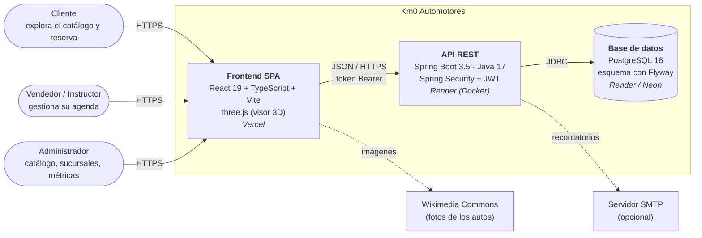
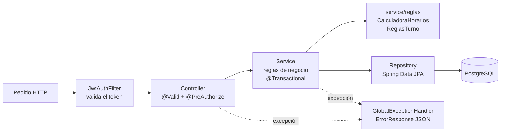
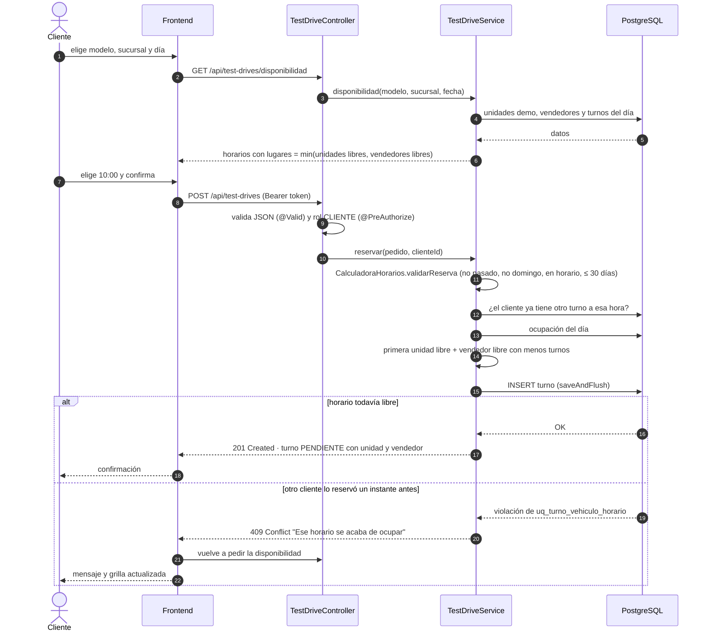
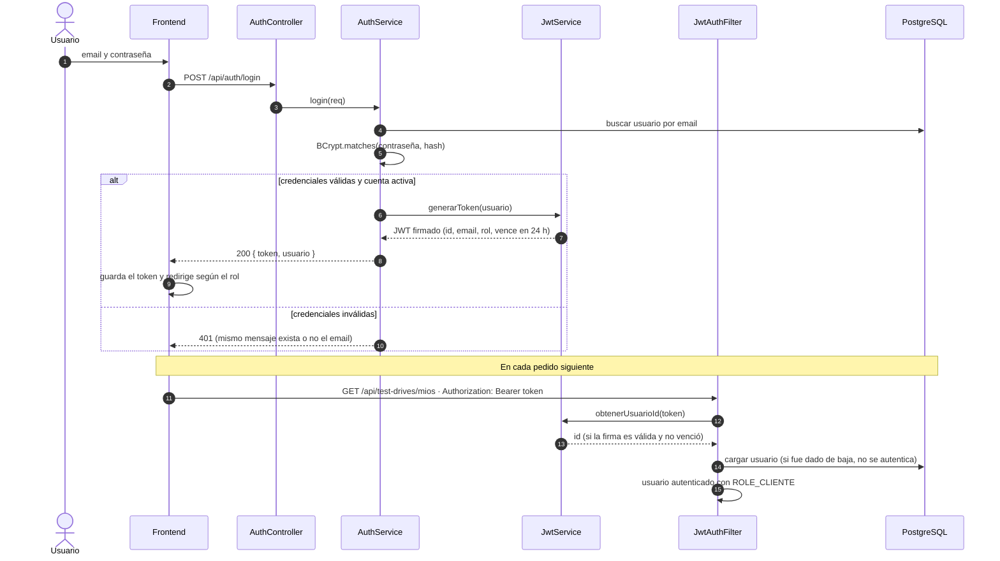
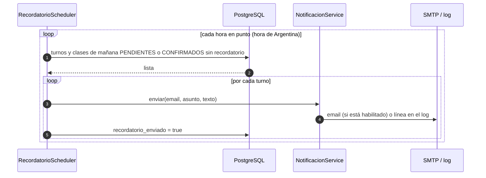
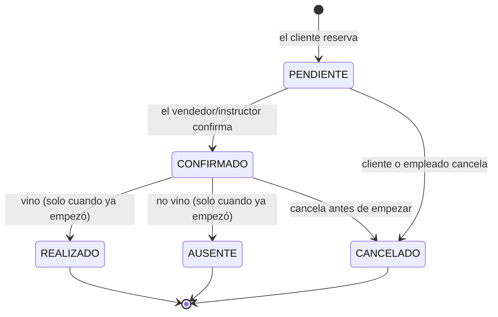
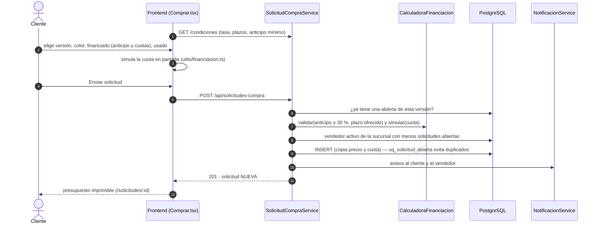
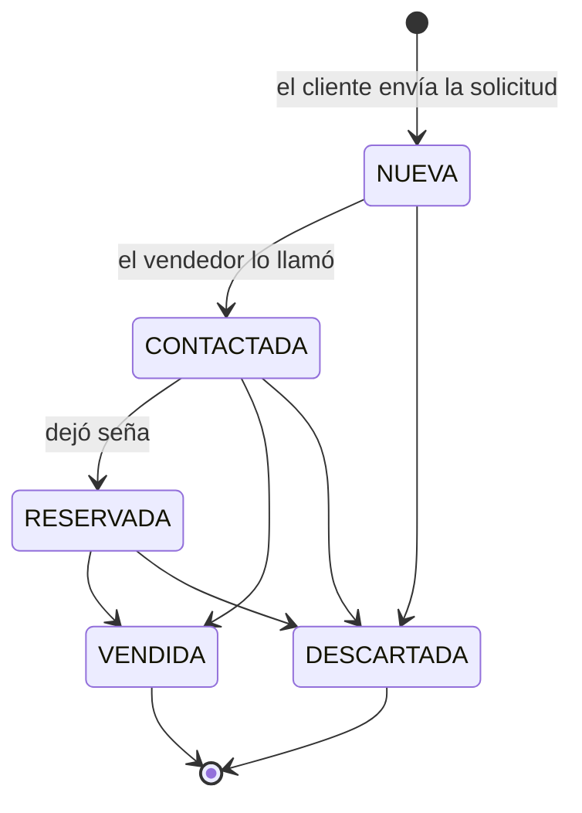

# Diagramas del sistema

Los diagramas están en [Mermaid](https://mermaid.js.org/): GitHub los muestra como imagen directamente.
Las mismas figuras exportadas en PNG (para el informe) están en [`img/diagramas/`](./img/diagramas).
Si se modifica un diagrama, se puede volver a exportar desde [mermaid.live](https://mermaid.live).

## 1. Arquitectura general (modelo C4, nivel de contenedores)

**Lectura.** Los usuarios solo interactúan con el frontend. El frontend no accede a la base: todo pasa
por la API, que valida el token, aplica las reglas de negocio y persiste en PostgreSQL. Las líneas
punteadas son integraciones opcionales: sin SMTP, los recordatorios se escriben en el log; si una foto
de Wikimedia no carga, se muestra una silueta del auto.

## 2. Capas del backend

## 3. Secuencia: reservar un test drive (incluye el caso de dos clientes a la vez)

**Lectura.** La validación del servicio cubre el caso normal y da mensajes claros (422 si la regla no se
cumple). El caso de dos pedidos simultáneos lo resuelve la base de datos con el índice único parcial:
el segundo INSERT falla y el cliente recibe un 409 en lugar de un turno duplicado (ver ADR-04).

## 4. Secuencia: login y pedido autenticado

## 5. Secuencia: recordatorio automático del día anterior

## 6. Estados de un turno

Las transiciones están en `EstadoTurno.java` (backend) y se repiten en `AccionesEstado.tsx` (frontend)
para mostrar solo los botones válidos. Un turno `CANCELADO` no ocupa el horario.

## 7. Solicitud de compra ("Quiero comprarlo")

El cliente puede desistir ("Ya no me interesa") mientras está NUEVA o CONTACTADA; con la unidad reservada,
tiene que hablar con el vendedor. Las transiciones están en `EstadoSolicitud.java` y se repiten en
`components/AccionesSolicitud.tsx`.

## 8. Modelo de datos

El diagrama entidad-relación completo está en [`esquema_bd_y_modulos.md`](./esquema_bd_y_modulos.md).
