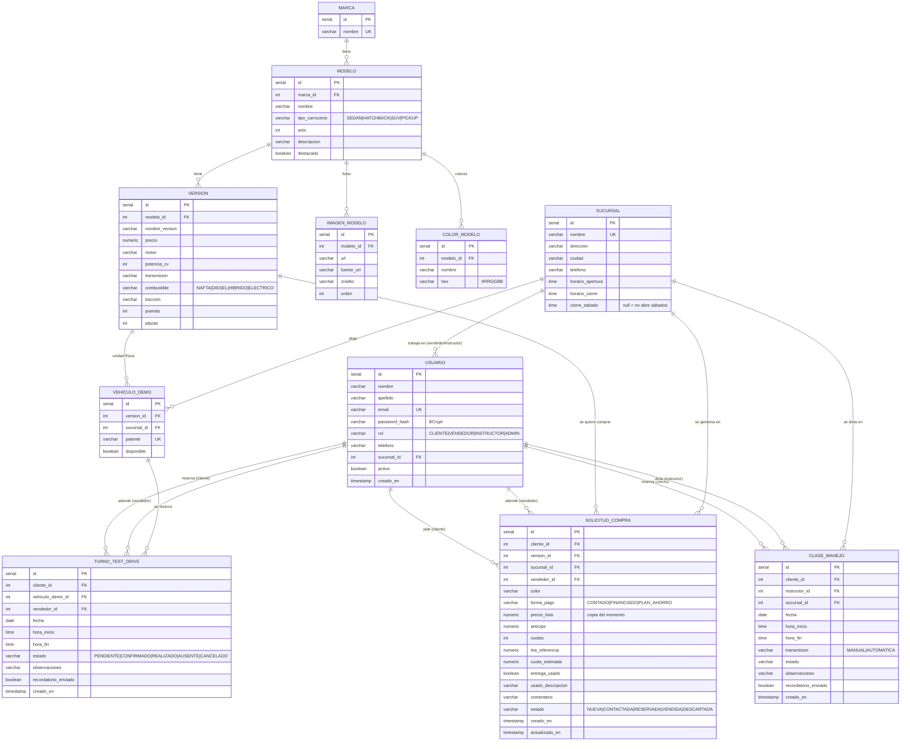

# Km0 Automotores — Esquema de Base de Datos y Módulos

## 1. Esquema de la base de datos (relacional — PostgreSQL 16)

Fuente de verdad: las migraciones Flyway en `backend/src/main/resources/db/migration`
(copia en [`database/`](../database)). Los cambios respecto del esquema aprobado en la
Segunda Entrega están explicados en [`cambios-esquema.md`](./cambios-esquema.md).

### Diagrama entidad-relación

### Entidades

| Entidad | Qué guarda |
|---|---|
| `marca` | Marcas que vende la concesionaria |
| `modelo` | Modelos de cada marca; `tipo_carroceria` define la forma del auto en el visor 3D |
| `version` | Versión con precio y ficha técnica (motor, potencia, caja, tracción) |
| `imagen_modelo` | Fotos de la galería, con la página de origen para dar crédito |
| `color_modelo` | Colores en los que se vende cada modelo (pintan el visor 3D) |
| `sucursal` | Sucursales y su horario de atención |
| `usuario` | Clientes y empleados (vendedores, instructores, administradores), diferenciados por `rol` |
| `vehiculo_demo` | Unidad física para test drive, de una versión y en una sucursal |
| `turno_test_drive` | Reserva de test drive: cliente, unidad, vendedor, día/hora y estado |
| `clase_manejo` | Reserva de clase de manejo: cliente, instructor, sucursal, tipo de caja, día/hora y estado |
| `solicitud_compra` | Interés de compra: versión, color, forma de pago (con la simulación del crédito), usado, vendedor asignado y estado de la venta |

### Restricciones de integridad

- **Sin superposiciones (índices únicos parciales)**, todos con `WHERE estado <> 'CANCELADO'`:
  - `uq_turno_vehiculo_horario (vehiculo_demo_id, fecha, hora_inicio)`: una unidad, un turno por horario.
  - `uq_turno_vendedor_horario (vendedor_id, fecha, hora_inicio)`: un vendedor atiende un turno a la vez.
  - `uq_clase_instructor_horario (instructor_id, fecha, hora_inicio)`: un instructor, una clase a la vez.
  - `uq_solicitud_abierta (cliente_id, version_id) WHERE estado IN ('NUEVA','CONTACTADA','RESERVADA')`: un cliente no puede tener dos solicitudes abiertas de la misma versión.
  Al ser parciales, cancelar un turno libera el horario para otra persona.
- `CHECK` sobre los valores válidos de `rol`, `estado`, `tipo_carroceria`, `combustible`, `transmision`, el formato `#RRGGBB` de los colores, `hora_fin > hora_inicio` y horarios de sucursal coherentes.
- `CHECK` en `usuario`: vendedores e instructores deben tener sucursal.
- `UNIQUE` en `marca.nombre`, `(marca_id, nombre)` de modelo, `(modelo_id, nombre_version)` de versión, `usuario.email`, `vehiculo_demo.patente`, `sucursal.nombre`.
- Claves foráneas sin borrado en cascada (no se puede borrar una versión con unidades, ni una unidad con turnos), salvo fotos y colores que se borran con su modelo.

### Índices principales

Postgres no indexa las claves foráneas automáticamente, así que se indexan las usadas en joins
y búsquedas: `modelo(marca_id)`, `version(modelo_id)`, `imagen_modelo(modelo_id)`,
`color_modelo(modelo_id)`, `vehiculo_demo(version_id)`, `vehiculo_demo(sucursal_id)`,
`usuario(sucursal_id)`, `usuario(rol)`, `turno_test_drive(cliente_id)`,
`turno_test_drive(vendedor_id, fecha)` (agenda del vendedor), `turno_test_drive(fecha, estado)`
(disponibilidad, alertas y métricas), `clase_manejo(cliente_id)`,
`clase_manejo(instructor_id, fecha)`, `clase_manejo(sucursal_id, fecha)`, `solicitud_compra(vendedor_id, estado)`
(panel del vendedor) y `solicitud_compra(estado, creado_en)` (listado del admin).

---

## 2. Módulos

| # | Módulo | Qué hace | Prioridad | Estado |
|---|---|---|---|---|
| 1 | Autenticación y usuarios | Registro de clientes, login con JWT, roles; el admin da de alta y de baja empleados | Alta | Implementado |
| 2 | Catálogo | Marcas, modelos y versiones con filtros, ficha con galería de fotos y visor 3D con colores, comparador de hasta 3 versiones | Alta | Implementado |
| 3 | Sucursales y unidades demo | ABM de sucursales (con horario) y de unidades para test drive | Alta | Implementado |
| 4 | Reserva de test drive | Disponibilidad en tiempo real por modelo/sucursal/día, reserva con asignación automática de unidad y vendedor, cancelación por el cliente | Alta | Implementado |
| 5 | Panel del vendedor | Agenda semanal, alertas de turnos sin confirmar, cambio de estado (confirmar, vino, no vino, cancelar) | Media | Implementado |
| 6 | Métricas y recordatorios (valor agregado) | Tablero con modelos y horarios más pedidos, asistencia, turnos por sucursal; listado de todas las reservas con filtros y exportación a Excel; recordatorio automático el día anterior | Media | Implementado |
| 7 | Escuela de manejo | Reserva de clases con instructor (elegido o asignado), caja manual o automática, agenda del instructor | Baja (adelantada) | Implementado |
| 8 | Solicitudes de compra (extensión) | Botón "Quiero comprarlo": versión, color, forma de pago con simulación de cuotas, usado; vendedor asignado; presupuesto imprimible; seguimiento de la venta por el vendedor y el admin | Extensión | Implementado |
